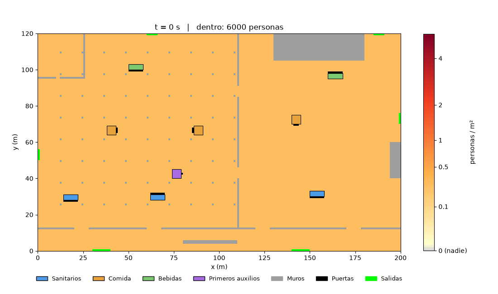
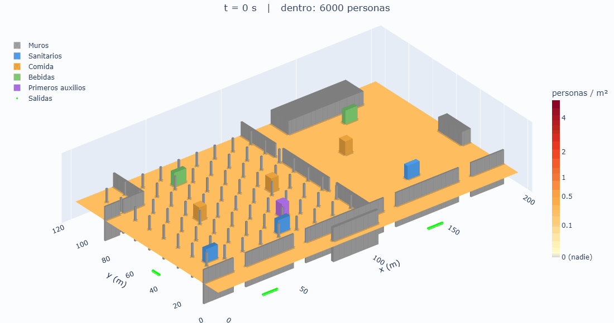
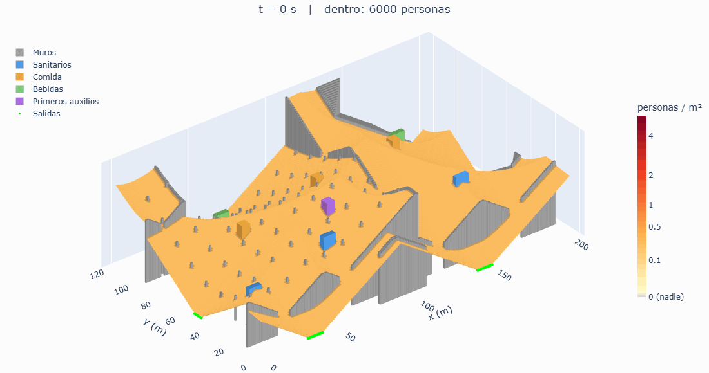

# Cuadernos

Cuadernos de Jupyter que explican cada parte del modelo con código corto y comparaciones visuales. Cada uno corre solo, en este orden de lectura:

| Cuaderno | Qué explica | Comparaciones principales |
|---|---|---|
| [eikonal.ipynb](eikonal.ipynb) | La distancia caminando, base de las dos funciones objetivo | línea recta contra caminando; Dijkstra con 4 y 8 vecinas contra Fast Marching (errores de 41 %, 8 % y 1 %); rutas resultantes |
| [p-mediana.ipynb](p-mediana.ipynb) | $f_1$: la p-mediana capacitada y su solución por precios | cada quien al más cercano contra con capacidad; precios contra el programa lineal exacto (mismo valor y mismas duales) |
| [evacuacion.ipynb](evacuacion.ipynb) | $f_2$: Weidmann, Godunov, Hughes y sus parámetros | Weidmann solo contra Godunov; cuencas de cada salida antes y durante la evacuación; recalcular T cada 0.3, 2.4, 9.6 s o nunca; Δt dentro y fuera de la condición CFL; módulos que estorban las salidas |
| [restricciones.ipynb](restricciones.ipynb) | Las seis restricciones duras y por qué se miden en grado | un ejemplo que viola cada una; la zona ocupable paso a paso; el ancho mínimo de paso |
| [multiobjetivo.ipynb](multiobjetivo.ipynb) | Pareto y NSGA-II | dominancia; suma ponderada contra ε-restricción; cruce y mutación; una corrida real de 24 × 15 sobre el recinto de prueba |
| [cuaderno-de-trabajo.ipynb](cuaderno-de-trabajo.ipynb) | El cuaderno donde se fue armando el modelo a mano, con las notas de estudio | sin salidas guardadas; las animaciones están abajo |

`multiobjetivo.ipynb` usa el evaluador del proyecto (`nucleo/` y `experimentos/`), así que se abre desde esta carpeta. Los demás traen su propia copia del recinto.

## Animaciones de la evacuación

Recinto de 200 × 120 m, 6,000 personas, 15 veces más rápido que el tiempo real.

**Vista desde arriba:** densidad en cada metro cuadrado.

**Isométrica:** la altura es la densidad.

**El recinto se vacía como un líquido:** el piso es la distancia a la salida (Eikonal) y encima va la densidad como altura extra.

## Para correrlos

Python 3.12 con `numpy`, `scipy`, `matplotlib`, `plotly`, `scikit-fmm` y `kaleido` (este último solo para las animaciones 3D del cuaderno de trabajo). En VS Code o JupyterLab, abrir el cuaderno y ejecutar todo. `evacuacion.ipynb` tarda alrededor de 1 minuto y `multiobjetivo.ipynb` alrededor de 1.5 minutos; los demás, segundos.
